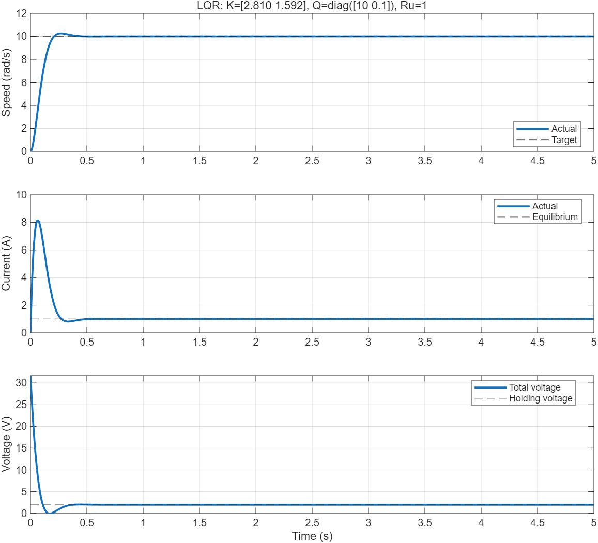

# 控制理论 MATLAB / Simulink 实践

控制理论学习项目，包含基础 LQR、直流电机 LQR 调速，以及 PID、超前滞后校正、Smith 和模糊控制相关练习。

## 环境

- MATLAB / Simulink（LQR 示例已在 R2025b 运行验证）
- Control System Toolbox（用于 `lqr`、状态空间与传递函数计算）
- 模糊推理系统相关模型可能需要 Fuzzy Logic Toolbox

在 MATLAB 中将当前文件夹设置为仓库根目录。

## 第一课：最简单的 LQR

```matlab
run_simple_lqr
```

模型：`simple_lqr_intro.slx`。
系统为 dx/dt=u，初值 x(0)=10，通过 u=-Kx 将状态控制到零。

```matlab
run_simple_lqr(4,1) % 更重视状态偏差
run_simple_lqr(1,4) % 更重视控制代价
```

详见 [基础 LQR 说明](simple_lqr_README.md)。

## 第二课：直流电机 LQR 调速

```matlab
run_motor_lqr
```

模型：`motor_lqr_intro.slx`。
以转速和电流为状态，电压为输入，采用工作点前馈与 LQR 状态反馈：

```text
u = u_ref - K * (x - x_ref)
```

默认从静止达到 10 rad/s，稳态电流为 1 A、稳态电压为 2 V。
该示例是参数已知、无外部负载、无限幅且状态均可获得的教学模型。

```matlab
run_motor_lqr(20,10,1) % 改变目标转速
run_motor_lqr(10,40,1) % 提高转速偏差权重
run_motor_lqr(10,10,4) % 提高电压修正量权重
```

详见 [电机 LQR 说明](motor_lqr_README.md)。



两个 LQR 运行脚本均包含与解析解的比较。参数实验会更新内存中的模型和结果图片；已有 `.slx` 文件不会自动覆盖，需要保留参数时可在 Simulink 中手动保存。

## 其他控制练习

保留原有文件名和目录结构，便于继续学习：

- `PID.slx`、`PID_classic.slx`、`PID_temp.slx`：PID 相关模型。
- `lead_lag.m`、`practice1.m`、`lead_lad.slx`：校正设计相关练习。
- `Smith.slx`、`typical_system.slx`：其他控制系统练习模型。
- `blur.m`、`blur_control.slx`、`myFis.fis`、`fuzzy_logic_designer/`：模糊控制相关练习。

这些原有练习的具体初始化变量和工具箱需求以各自模型与脚本为准，本次仓库整理未重新验证它们。

## 版本管理

提交 MATLAB 脚本、Simulink 模型、FIS 文件、说明文档和教学结果图片。
仿真缓存 `slprj/`、`*.slxc`、自动保存文件和日志由 `.gitignore` 排除。
